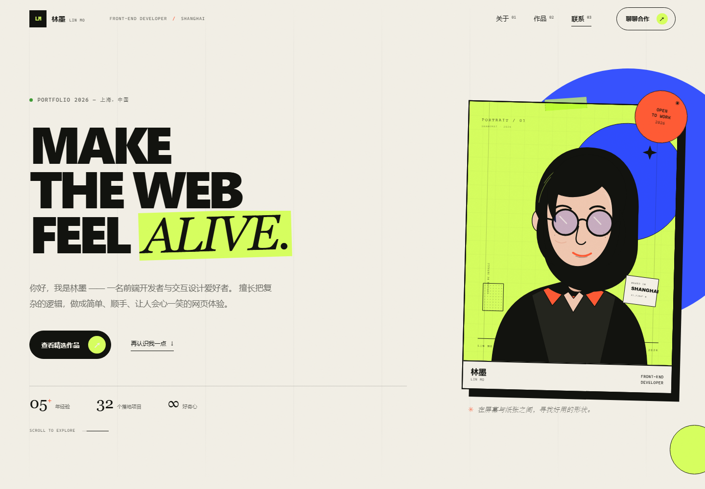
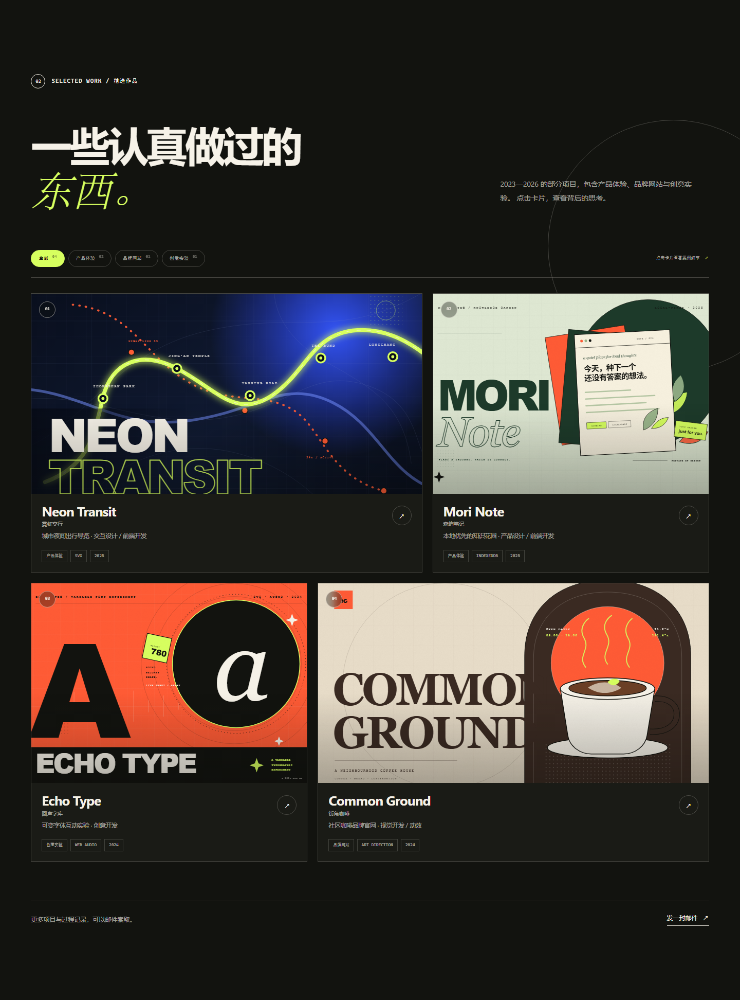
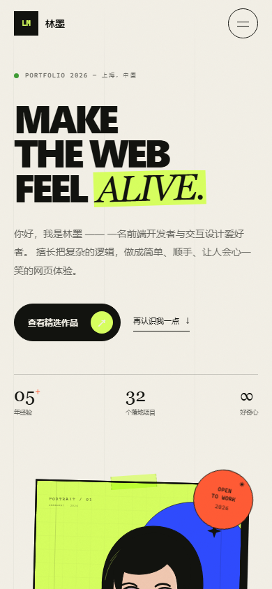

# 林墨 Lin Mo · 个人作品集

一个**不依赖框架、不需要构建**的个人作品集网站，用 HTML + CSS + 原生 JavaScript 与手写 SVG 搭建。

视觉上混合了编辑杂志式排印、新粗野主义边框和酸绿 / 钴蓝 / 橙红的强对比，包含完整响应式、作品筛选、项目详情弹窗、移动端全屏菜单和邮箱复制反馈。



---

## ✨ 功能

- **单页结构**：首页 Hero、关于、作品、联系、页脚。
- **4 个精选项目**：分类筛选 + 原生 `<dialog>` 详情弹窗。
- **响应式布局**：桌面 / 平板 / 手机完整适配，无横向滚动。
- **移动端全屏菜单**：锁定滚动、Esc 关闭、焦点管理。
- **无障碍细节**：跳转主内容、键盘操作、`aria` 状态、焦点恢复、减少动态偏好。
- **零依赖**：无第三方库、无网络字体、无请求外部资源。
- **可直接打开**：双击 `index.html` 即可运行，也可以用任意静态服务器预览。
- **配套文档**：PRD、技术设计、Agent.md 维护指南。



---

## 🚀 本地打开 / 预览

### 方式一：直接双击（最快）

1. 打开 `linmo-portfolio` 文件夹。
2. 双击 `index.html`。
3. 浏览器会以 `file://` 打开页面，全部功能可用。

### 方式二：本地静态服务器（推荐）

在项目根目录打开终端，执行：

```powershell
python -m http.server 8080
```

或（已安装 Node.js）：

```powershell
npx serve . -l 8080
```

然后访问：

```text
http://localhost:8080/
```

停止服务器：在终端按 `Ctrl + C`。

> 如果使用 VS Code，也可以安装 **Live Server** 扩展，右键 `index.html` → **Open with Live Server**。

---

## 📱 移动端预览



开发时可用浏览器 DevTools 的设备模拟：

1. 按 `F12` 打开开发者工具。
2. 点击左上角「设备切换」图标（`Ctrl + Shift + M`）。
3. 选择 iPhone 14 / 390 × 844，刷新页面。

---

## 📁 项目结构

```text
linmo-portfolio/
├── index.html                    # 页面结构、文案与项目模板
├── css/styles.css                # 全站样式与响应式
├── js/main.js                    # 原生交互
├── assets/images/                # 人物插画、项目封面、favicon
├── docs/
│   ├── PRD.md                    # 产品需求文档
│   └── TECH_DESIGN.md            # 技术设计文档
├── Agent.md                      # 面向 AI 编程助手的维护指南
├── README.md
└── preview/                      # 预览截图
```

---

## 📚 配套文档

| 文档 | 内容 |
| --- | --- |
| [PRD 产品需求文档](docs/PRD.md) | 产品定位、目标用户、功能清单、交互说明、验收标准 |
| [技术设计文档](docs/TECH_DESIGN.md) | 技术栈、目录结构、页面架构、资源管理、测试与部署 |
| [Agent.md](Agent.md) | AI 编程助手维护规范、代码约定、常见修改流程 |
| [README.md](README.md) | 本地运行与项目概览 |

---

## 🛠 自定义指南

### 替换个人信息

在 `index.html` 中搜索：

- `林墨` / `Lin Mo`
- `hello@linmo.design`
- `上海`
- `2026 Q4`

同步更新页头、Hero、Mobile Menu、联系区、页脚和 JSON-LD。

### 替换项目

1. 将封面放入 `assets/images/projects/`。
2. 复制一张 `.project-card`，修改 `data-category`、`data-project`、封面与文字。
3. 复制对应的 `<template id="detail-...">`，填写项目详情。
4. 更新筛选按钮上的计数。

完整步骤见 [Agent.md](Agent.md) 第 4.3 节。

### 修改配色

编辑 `css/styles.css` 顶部的 `:root` Token：

```css
--paper: #f2efe6;
--ink: #12130f;
--acid: #d7ff5f;
--orange: #ff5b35;
--cobalt: #2f4bff;
```

---

## ✅ 已验证

| 项目 | 结果 |
| --- | --- |
| 桌面 1440 × 1000 / 1920 × 1080 | 通过，无横向滚动 |
| 平板 768 × 1024 | 通过，作品两列等宽 |
| 移动 390 × 844 / 320 × 720 | 通过，无横向滚动 |
| 菜单 / 筛选 / 弹窗 / 复制邮箱 | 通过 |
| 控制台报错 | 0 |
| 图片资源 404 | 0 |
| `file://` 直接打开 | 通过 |

---

## 🌐 部署

直接将整个项目目录上传到任意静态托管服务：

- **GitHub Pages**：仓库 Settings → Pages → 选择分支根目录。
- **Cloudflare Pages**：Build command 留空，输出目录填项目根目录。
- **Netlify**：拖拽整个文件夹到部署页面。
- **Vercel**：Framework 选择 Other，Build / Output 留空。

项目全部使用相对路径，支持部署在子目录（如 `username.github.io/portfolio/`）。

---

## 📄 说明

- 当前人物「林墨 Lin Mo」、项目案例、数据指标、邮箱及社交链接均为**演示内容**，上线前请替换为真实信息。
- 项目不收集访客数据，不使用 Cookie，不加载第三方脚本。
- 代码可自由用于个人作品集；替换的图片、字体与案例内容请自行确认授权。

---

**Built with care, HTML, CSS & vanilla JavaScript.**
